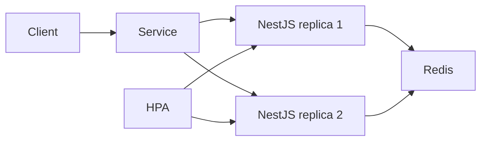

# Kubernetes High Availability Lab

[](https://github.com/yashybm30/k8s-high-availability-lab/actions/workflows/ci.yml)

A reproducible lab for separating application availability from dependency health.

## Implemented features

- NestJS API with dependency-independent liveness and Redis-backed readiness
- Bounded CPU workload, shared Redis counter, Prometheus metrics and correlation IDs
- Two API replicas, rolling updates, topology spreading, HPA, ingress and disruption budgets
- k6 load profile and context-restricted node-drain experiment script

## Architecture



Stack: NestJS, TypeScript, Redis, Docker, Kubernetes, kind, k6.

## Local setup

Requirements: Node.js 24, npm, Docker Engine with Compose v2. The HA cluster experiments additionally require kind, kubectl, metrics-server and k6. Examples use bash; set environment variables with the corresponding syntax in your shell.

```bash
cp .env.example .env
# Edit .env before starting. Use independent random secrets, never example values.
npm ci
npm run check
docker compose --env-file .env up --build -d
```

Run one portfolio stack at a time because development ports overlap. Docker Compose requires the CLI `--env-file` for values interpolated into configuration. For native execution, `npm start` reads `.env` automatically after `npm run build`.

## Configuration

| Variable | Purpose |
|---|---|
| `PORT` | HTTP port, default 3000 |
| `REDIS_URL` | Redis connection; localhost for native execution, service hostname in Compose |
| `CORS_ORIGIN` | Comma-separated browser-origin allowlist; defaults to none |

## API usage

| Endpoint | Behavior |
|---|---|
| `/health/live` | Process health; independent of Redis |
| `/health/ready` | 200 with Redis available, otherwise 503 |
| `/v1/work?iterations=100000` | Bounded CPU work and shared Redis counter |
| `/metrics` | Prometheus exposition |
| `/docs` | Swagger UI |

```bash
curl http://localhost:3000/v1/work?iterations=100000
curl http://localhost:3000/metrics
```

`iterations` must be an integer from 1 through 500000. The endpoint is a synthetic lab workload and is intentionally unauthenticated. Restrict access to the lab network.

## Validation

```bash
npm run check              # lint, strict typecheck, unit/API tests, build
npm run test:integration   # real services must be running
npm run test:coverage      # combined unit + integration coverage; services required
```

Tests run the compiled application so NestJS decorator metadata matches production. Coverage includes compiled application code; bootstrap, external OAuth callbacks and telemetry initialization are excluded and require separate configured verification. Integration tests create isolated identities; they require disposable databases and must never target production.

See [cluster experiments](docs/experiments.md) for kind setup, k6 load and node drain. Save actual output before reporting recovery or scaling results.

## Deployment

Build the non-root image with `docker build -t k8s-high-availability-lab:local .`. Compose is the supported local deployment. For GCP, publish the image to Artifact Registry and use Cloud Run or GKE with private database connectivity and secret injection; cloud resources and credentials are intentionally not provisioned. Configure TLS, network restrictions, resource budgets and graceful termination for the target environment. Kubernetes manifests and the disposable kind configuration are in `k8s/`. See the experiment guide before draining any node.

## Security

See [SECURITY.md](SECURITY.md). Never commit `.env`; `.env.example` contains configuration examples only. Dependency scanning runs in CI. Database and Redis development ports bind localhost. No production cloud resources are changed by this project.

## Trade-offs and known limitations

The singleton Redis is deliberately not HA. Its disruption budget prevents voluntary eviction but cannot prevent machine failure. No drain or HPA timing is claimed without an actual cluster experiment. CPU work is intentionally synthetic and must not be exposed to the internet without edge throttling.

## Roadmap

Add managed Redis failover, automated cluster experiments, and network policies.

MIT licensed. See [CONTRIBUTING.md](CONTRIBUTING.md) for the review workflow.
